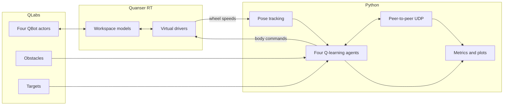
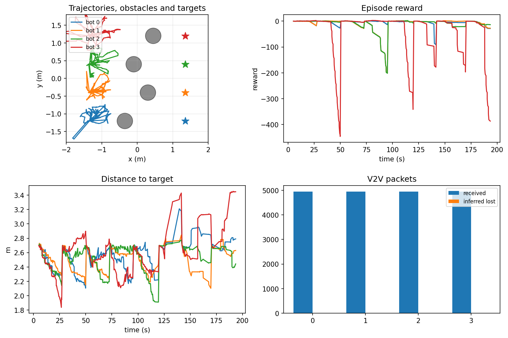

# Four-QBot distributed RL demo

A Quanser QLabs project for experimenting with multi-robot communication and
distributed reinforcement learning. Four QBot Platforms learn to reach separate
targets, avoid obstacles and one another, and share Q-values over UDP.

The project also includes a small leader/follower demo for checking the
simulator and network setup before starting a training run.

## What it does

- Spawns four independently controlled QBot Platforms.
- Gives every robot a target and places an obstacle in its lane.
- Runs a tabular Q-learning agent on each robot.
- Shares Q-values directly between peers over UDP.
- Tracks pose with wheel odometry and occasional QLabs corrections.
- Plots trajectories, rewards, target distance, and network traffic live.
- Records every run to CSV and saves the learned Q-tables.
- Saves partial results and disarms the robots when stopped with `Ctrl+C`.

## System overview



Each robot has its own Q-table and chooses its own action. There is no central
policy server; the main process schedules the agents and records the run.

## Requirements

- Windows with the Quanser software stack configured
- Quanser Interactive Labs
- QBot Platform Warehouse/Open World
- Python with the repository's `qvl`, `pal`, and `quanser` packages
- NumPy and Matplotlib

This project expects the normal Quanser environment variables and Python path
to already be configured.

The non-Quanser Python dependencies can be installed with:

```powershell
python -m pip install -r requirements.txt
```

## Running the demos

Open QLabs and load the **QBot Platform Warehouse/Open World**, then open
PowerShell in this directory.

### Check the four-bot setup

```powershell
python .\run_four_qbots.py
```

Bot 0 sends an oscillating forward/turn command. Bots 1-3 copy the newest
leader command received over UDP. A follower stops if the leader packet is more
than 0.5 seconds old.

```powershell
python .\run_four_qbots.py --duration 60 --rate 50
```

### Run distributed Q-learning

Start with a short test:

```powershell
python .\run_distributed_rl.py --episodes 2 --steps 100 --rate 10
```

For a longer run:

```powershell
python .\run_distributed_rl.py --episodes 8 --steps 220 --rate 10
```

Record without opening the Matplotlib window:

```powershell
python .\run_distributed_rl.py --episodes 8 --steps 220 --rate 10 --no-plot
```

If QLabs reports frequent missed pose corrections, query it less often:

```powershell
python .\run_distributed_rl.py --ground-truth-period 4
```

A missed correction is not fatal. The robot continues on wheel odometry and
tries again later.

## Environment

The robots begin on the left side of the map and travel toward targets on the
right.

| Bot | Start `(x, y)` m | Target `(x, y)` m | Obstacle `(x, y)` m |
| --- | --- | --- | --- |
| 0 | `(-1.35, -1.20)` | `(1.35, -1.20)` | `(-0.35, -1.20)` |
| 1 | `(-1.35, -0.40)` | `(1.35, -0.40)` | `(0.30, -0.40)` |
| 2 | `(-1.35, 0.40)` | `(1.35, 0.40)` | `(-0.10, 0.40)` |
| 3 | `(-1.35, 1.20)` | `(1.35, 1.20)` | `(0.45, 1.20)` |

Targets are colored markers with collisions disabled. Obstacles are static,
collision-enabled cylinders with a radius of 0.22 m.

## Learning setup

The local state is:

```text
distance_bin:bearing_bin:front_blocked
```

Target distance has four bins, target bearing has eight 45-degree sectors, and
`front_blocked` is set when an obstacle or robot is close in front. This gives
at most \(4\times8\times2=64\) states.

| Action | Forward m/s | Turn rad/s |
| --- | ---: | ---: |
| Stop | 0.00 | 0.00 |
| Forward | 0.13 | 0.00 |
| Forward-left | 0.08 | 0.65 |
| Forward-right | 0.08 | -0.65 |
| Rotate left | 0.00 | 0.75 |
| Rotate right | 0.00 | -0.75 |

The Q-learning update is:

$$
Q(s,a)\leftarrow Q(s,a)+\alpha
\left[r+\gamma\max_{a'}Q(s',a')-Q(s,a)\right]
$$

with \(\alpha=0.25\) and \(\gamma=0.92\). The reward favors progress and
arrival while penalizing time, unsafe clearance, and collisions:

$$
r =
8(d_{\mathrm{previous}}-d_{\mathrm{current}})
-0.02
-0.25\,\mathbf{1}[\mathrm{clearance}<0.20]
-5\,\mathbf{1}[\mathrm{collision}]
+10\,\mathbf{1}[\mathrm{target}]
$$

Exploration starts at \(\epsilon=0.35\), is multiplied by 0.94 after each
episode, and never falls below 0.05.

## Distributed communication

The RL nodes use UDP ports `21000-21003`. Messages contain the sender, episode,
step, state, action, reward, target distance, terminal flags, and six Q-values.

When agent \(i\) receives a row from agent \(j\), it applies:

$$
\mathbf{Q}_i(s)\leftarrow
0.85\,\mathbf{Q}_i(s)+0.15\,\mathbf{Q}_j(s)
$$

This is a lightweight consensus rule rather than centralized training. An agent
can continue learning if peer messages are missing.

| Bot | Driver | Basic UDP | RL UDP |
| --- | ---: | ---: | ---: |
| 0 | 18970 | 20000 | 21000 |
| 1 | 18971 | 20001 | 21001 |
| 2 | 18972 | 20002 | 21002 |
| 3 | 18973 | 20003 | 21003 |

## Pose tracking

Polling four QLabs transforms every step is slow and can lead to missed
responses. The experiment integrates measured wheel speeds:

$$
v=\frac{r}{2}(\omega_L+\omega_R),
\qquad
\omega=\frac{r}{L}(\omega_R-\omega_L)
$$

and uses midpoint integration:

$$
\begin{aligned}
\theta_m &= \theta+\frac{\omega\Delta t}{2},\\
x' &= x+v\cos(\theta_m)\Delta t,\\
y' &= y+v\sin(\theta_m)\Delta t,\\
\theta' &= \operatorname{wrap}(\theta+\omega\Delta t).
\end{aligned}
$$

One robot at a time receives a ground-truth correction. The default period is
two seconds per robot.

## Dashboard and recordings

The dashboard shows trajectories, current-episode reward, target distance, and
received/inferred-lost packets.

Every run is stored under:

```text
runs/run_YYYYMMDD_HHMMSS_microseconds/
```

| File | Contents |
| --- | --- |
| `config.json` | Options, geometry, actions, and ports |
| `telemetry.csv` | One row per robot per control step |
| `q_table_bot_*.json` | Final table for each robot |
| `metrics.png` | Final dashboard when plotting is enabled |

The `runs/` directory is ignored by Git, so local experiments are not committed
by accident.

Important CSV fields include pose/source, target distance, clearance, state,
action, reward, collision and target flags, wheel speeds, packet counts,
message age, pose-query misses, and actual loop period.



## Project layout

```text
four_qbot_demo/
├── run_four_qbots.py
├── run_distributed_rl.py
├── distributed_rl.py
├── v2v.py
├── metrics.py
├── requirements.txt
├── docs/
│   ├── dashboard.png
│   └── technical-reference.md
├── README.md
└── LICENSE
```

The [technical reference](docs/technical-reference.md) contains the UML class
diagram, control sequence, state machine, full equations, function-by-function
notes, and complete telemetry reference.

## Troubleshooting

### A driver does not connect

Make sure QLabs and the Quanser target manager are running. Close old scripts
using ports `18970-18973`, then start again. `MultiAgent` restarts the RT models.

### Missed QLabs pose correction

An occasional warning is expected. If it happens often, increase
`--ground-truth-period` to 4 or more seconds.

### The requested rate is not reached

At 10 Hz, `control_period_ms` should be near 100 ms. Larger values usually mean
QLabs, driver communication, plotting, or CPU load took longer than one period.
Try `--no-plot` or increase the correction period.

### Stopping a run

Press `Ctrl+C` once and wait for cleanup. The program saves the data collected
so far and sends zero/disarm commands to all four robots.

## Notes

- Obstacle observations use known geometry rather than lidar.
- Q-tables start fresh on every invocation.
- All agents run in one process, even though communication uses UDP.
- Localhost has little natural latency or loss; impairment can be added later.
- The circle-based collision check approximates QLabs physics.

## License

BSD 3-Clause. See [LICENSE](LICENSE).
