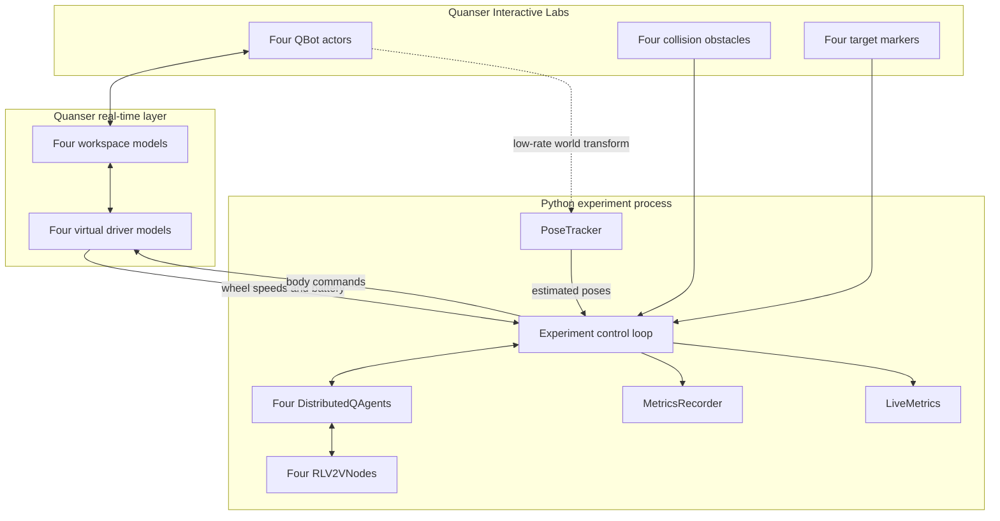
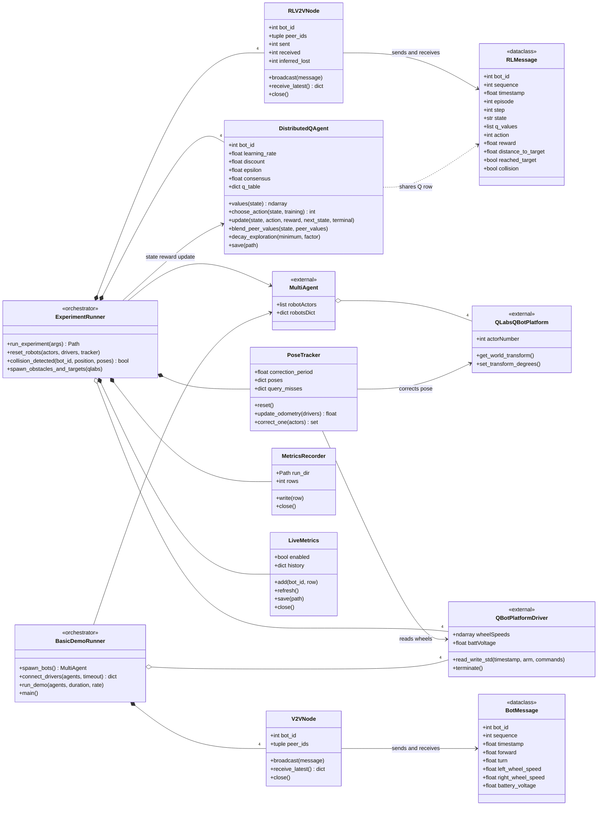
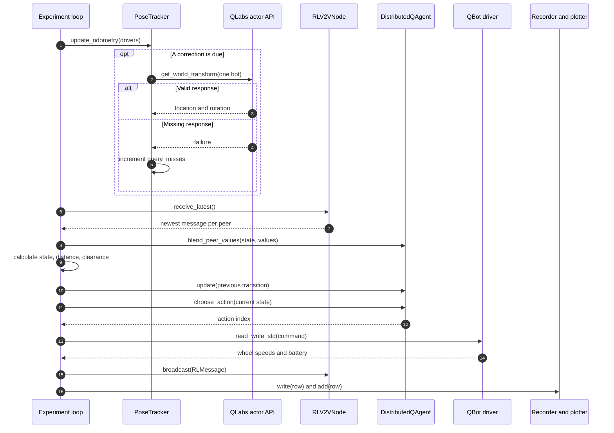
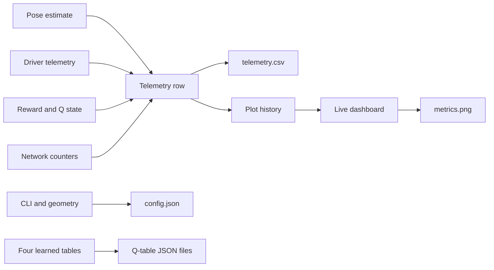

# Technical reference

[Back to the project README](../README.md)

This directory contains two related Quanser QLabs experiments:

1. `run_four_qbots.py` is a minimal vehicle-to-vehicle communication demo. Bot 0 generates a velocity command and bots 1-3 reproduce it after receiving it over UDP.
2. `run_distributed_rl.py` is a four-agent tabular Q-learning experiment. Each robot learns its own obstacle-avoiding target policy and exchanges Q-values with the other robots. A live dashboard displays training metrics and every run is recorded.

The algorithms are intentionally small and explicit. This is a starting point for multi-agent control, distributed learning, network-quality, localization, and instrumentation experiments—not a production navigation stack.

## Contents

- [Requirements and preparation](#requirements-and-preparation)
- [Quick start](#quick-start)
- [Architecture](#architecture)
- [UML and behavioral diagrams](#uml-and-behavioral-diagrams)
- [Actors, drivers, and ports](#actors-drivers-and-ports)
- [Environment geometry](#environment-geometry)
- [Motion model and odometry](#motion-model-and-odometry)
- [RL state](#rl-state)
- [Actions and rewards](#actions-and-rewards)
- [Q-learning](#q-learning)
- [Distributed consensus](#distributed-consensus)
- [Mathematical reference](#mathematical-reference)
- [UDP communication](#udp-communication)
- [Control-loop sequence](#control-loop-sequence)
- [Plots and outputs](#plots-and-outputs)
- [Telemetry reference](#telemetry-reference)
- [Function reference](#function-reference)
- [Parameters and tuning](#parameters-and-tuning)
- [Failure handling](#failure-handling)
- [Limitations and extensions](#limitations-and-extensions)

## Requirements and preparation

The parent Quanser repository must already be configured. The example uses the Quanser `qvl`, `pal`, and `quanser` packages, NumPy, and Matplotlib.

Before running either experiment:

1. Start Quanser Interactive Labs.
2. Open the **QBot Platform Warehouse/Open World**.
3. Open PowerShell in this directory.

Quanser's `MultiAgent` helper stops existing real-time models and replaces existing robot actors. It does not remove the Warehouse/Open World itself. Do not simultaneously run another program using the same driver or UDP ports.

## Quick start

Basic communication demo:

```powershell
python .\run_four_qbots.py
python .\run_four_qbots.py --duration 60 --rate 50
```

Short RL validation run:

```powershell
python .\run_distributed_rl.py --episodes 2 --steps 100 --rate 10
```

Longer training run:

```powershell
python .\run_distributed_rl.py --episodes 8 --steps 220 --rate 10
```

Run without the dashboard:

```powershell
python .\run_distributed_rl.py --episodes 8 --steps 220 --rate 10 --no-plot
```

Reduce QLabs pose-query traffic:

```powershell
python .\run_distributed_rl.py --ground-truth-period 4
```

Press `Ctrl+C` for a safe stop. Cleanup disarms the robots, closes driver streams and UDP sockets, saves Q-tables, flushes telemetry, and closes QLabs.

## Architecture



All agents currently execute in one Python process, but they communicate through real UDP sockets. There is no central policy: every robot owns a separate Q-table and selects its own action. The main loop schedules them and records results.

## UML and behavioral diagrams

These are GitHub-native Mermaid diagrams. `ExperimentRunner` represents the
orchestration performed by `run_experiment()`; it is not a literal Python class.

### UML class diagram



### One control-step sequence



The agent, driver, network, and metric operations repeat once per robot.

### Robot episode state machine

```mermaid
stateDiagram-v2
    [*] --> Resetting
    Resetting --> Active: transform confirmed and settled
    Resetting --> Failed: three reset attempts fail
    Active --> Active: observe, learn, communicate, act
    Active --> Reached: target distance below 0.25 m
    Active --> Collided: collision condition true
    Active --> TimedOut: maximum steps reached
    Reached --> Stopped: action 0 and arm 0
    Collided --> Stopped: action 0 and arm 0
    TimedOut --> Stopped: episode complete
    Stopped --> Resetting: next episode
    Failed --> [*]
```



### Data and artifact flow



## Actors, drivers, and ports

`qvl.multi_agent.MultiAgent` creates a QLabs actor, workspace RT model, and virtual driver for each QBot.

| Bot | Actor | HIL | Driver | RL UDP | Basic UDP |
| --- | ---: | ---: | ---: | ---: | ---: |
| 0 | 0 | 18950 | 18970 | 21000 | 20000 |
| 1 | 1 | 18951 | 18971 | 21001 | 20001 |
| 2 | 2 | 18952 | 18972 | 21002 | 20002 |
| 3 | 3 | 18953 | 18973 | 21003 | 20003 |

Drivers use mode 1, accepting body commands:

```text
command = [forward velocity (m/s), yaw rate (rad/s)]
```

The driver returns wheel positions/speeds, actual motor commands, accelerometer, gyroscope, currents, battery voltage, watchdog state, and timestamp. This experiment records wheel speeds and battery voltage.

## Environment geometry

The ground is the `x-y` plane and yaw is rotation about `z`. Robots start facing positive `x`.

| Bot | Start `(x, y, z)` m | Target `(x, y, z)` m |
| --- | --- | --- |
| 0 | `(-1.35, -1.20, 0)` | `(1.35, -1.20, 0)` |
| 1 | `(-1.35, -0.40, 0)` | `(1.35, -0.40, 0)` |
| 2 | `(-1.35,  0.40, 0)` | `(1.35,  0.40, 0)` |
| 3 | `(-1.35,  1.20, 0)` | `(1.35,  1.20, 0)` |

Targets are flat colored cylinders with collisions and dynamics disabled.

| Obstacle | Center `(x, y)` m | Radius m |
| --- | --- | ---: |
| 0 | `(-0.35, -1.20)` | 0.22 |
| 1 | `( 0.30, -0.40)` | 0.22 |
| 2 | `(-0.10,  0.40)` | 0.22 |
| 3 | `( 0.45,  1.20)` | 0.22 |

Obstacles are static collision-enabled cylinders. Actor IDs `100-103` belong to obstacles and `200-203` to targets. Collision math approximates a robot by a circle.

## Motion model and odometry

QLabs `get_world_transform()` is synchronous. Polling all actors every step overloaded QLabs, so `PoseTracker` uses wheel odometry and low-rate round-robin ground-truth corrections.

Let:

- `r` = wheel radius;
- `L` = wheel separation;
- `ωL`, `ωR` = measured wheel angular speeds;
- `Δt` = elapsed monotonic time.

Forward velocity and yaw rate are:

```text
v = r(ωL + ωR) / 2
ω = r(ωR - ωL) / L
```

Midpoint integration is used:

```text
θmid   = θ + ωΔt/2
x_next = x + v cos(θmid) Δt
y_next = y + v sin(θmid) Δt
θ_next = wrap(θ + ωΔt)
```

Midpoint integration is more accurate on a curved step than translating entirely at the old or new heading. `Δt` is clamped to `0.5 s` so a debugger pause cannot create one huge pose jump.

Angle wrapping is:

```text
wrap(θ) = (θ + π) mod 2π - π
```

so yaw remains in `[-π, π)`.

If the per-robot correction period is `T`, one robot is queried every `T/4` seconds. At default `T = 2 s`, QLabs receives about two total pose queries per second. A missed response increments `pose_query_misses` and odometry continues.

Each episode begins by disarming the robots, moving them to their starts, waiting `0.5 s`, and resetting odometry to the known initial poses.

## RL state

`state_key()` maps continuous geometry to:

```text
distance_bin:bearing_bin:front_blocked
```

Example: `3:4:0`.

### Target distance

For robot `(x,y)` and target `(xt,yt)`:

```text
dx = xt - x
dy = yt - y
d  = sqrt(dx² + dy²)
```

| Bin | Range |
| ---: | --- |
| 0 | `d < 0.25 m` (target reached) |
| 1 | `0.25 ≤ d < 0.75 m` |
| 2 | `0.75 ≤ d < 1.50 m` |
| 3 | `d ≥ 1.50 m` |

### Target bearing

```text
b = wrap(atan2(dy, dx) - yaw)
bearing_bin = floor(((b + π) / 2π) × 8) mod 8
```

This divides `[-π,π)` into eight `45°` sectors.

### Clearance and blocked flag

Obstacles and peers are circles. For hazard center `(xh,yh)`, hazard radius `rh`, and robot radius `rr = 0.18 m`:

```text
center_distance = sqrt((xh-x)² + (yh-y)²)
clearance = center_distance - rh - rr
```

`nearest_clearance` is the minimum across hazards. A negative value means circular overlap. `front_blocked = 1` when:

```text
clearance < 0.42 m
and
|relative hazard bearing| < 65°
```

Otherwise it is zero. The theoretical state space has `4 × 8 × 2 = 64` states.

This version uses known geometry and estimated poses—not lidar—to form the observation.

## Actions and rewards

### Actions

| Index | Action | Forward m/s | Yaw rad/s |
| ---: | --- | ---: | ---: |
| 0 | stop | 0.00 | 0.00 |
| 1 | forward | 0.13 | 0.00 |
| 2 | forward-left | 0.08 | 0.65 |
| 3 | forward-right | 0.08 | -0.65 |
| 4 | left | 0.00 | 0.75 |
| 5 | right | 0.00 | -0.75 |

A target or collision forces action 0 and disarms that robot for the episode.

### Reward

Progress is the reduction in target distance:

```text
progress = d_previous - d_current
reward = 8 × progress - 0.02
```

Additional terms:

| Event | Adjustment |
| --- | ---: |
| Clearance below `0.20 m` | `-0.25` |
| Collision | `-5.0` |
| Target reached | `+10.0` |

Moving `0.03 m` closer safely gives `8(0.03)-0.02 = +0.22`. Moving `0.01 m` away gives `8(-0.01)-0.02 = -0.10`. Step zero has reward zero because no earlier transition exists.

Collision is declared if:

- `|x| > 1.85 m` or `|y| > 1.65 m`;
- obstacle-center distance is below `obstacle radius + 0.17 m`;
- peer-center distance is below `0.31 m`.

These software tests supplement visible QLabs physics.

## Q-learning

Each state maps to six action values:

```text
Q[state] = [Q(stop), Q(forward), Q(forward-left), ...]
```

New rows start at zero. For state `s`, action `a`, reward `r`, next state `s'`, learning rate `α`, and discount `γ`:

```text
target = r + γ max_a' Q(s',a')
Q(s,a) ← Q(s,a) + α[target - Q(s,a)]
```

Defaults are `α = 0.25` and `γ = 0.92`. On terminal transitions, future value is zero, so `target = r`.

### Epsilon-greedy selection

With probability `ε`, a random action is used. Otherwise a maximum-Q action is selected. Maximum ties are randomly broken so an unseen zero-valued row does not always choose stop.

Initial `ε = 0.35`. After every episode:

```text
ε_next = max(0.05, 0.94 ε)
```

Agent `i` uses random seed `seed + i`, giving reproducible but different exploration.

## Distributed consensus

Agents broadcast the Q-row for their current state. Receiver `i` blends a peer row using:

```text
Q_i(s) ← (1-β)Q_i(s) + βQ_peer(s)
```

with `β = 0.15`. The result is 85% local and 15% peer value. Multiple peer rows are applied sequentially. Wrong-length rows are ignored.

This is decentralized policy sharing: each robot retains its own table and action selection, and learning continues without messages. Sequential blending is order-dependent and is an educational consensus mechanism, not a formally convergent distributed optimizer.

## Mathematical reference

This section uses GitHub-supported LaTeX delimiters. Inline expressions use
dollar signs, while display expressions use fenced `math` blocks.

### Angle normalization

For any angle $\theta$, normalization to $[-\pi,\pi)$ is

```math
\mathrm{wrap}(\theta)
= ((\theta+\pi)\bmod 2\pi)-\pi .
```

### Differential-drive forward kinematics

Given wheel radius $r$, wheel separation $L$, and measured left/right wheel
angular velocities $\omega_L,\omega_R$,

```math
v = \frac{r}{2}(\omega_L+\omega_R),
\qquad
\omega = \frac{r}{L}(\omega_R-\omega_L).
```

The first quantity is body-forward velocity and the second is body yaw rate.

### Midpoint pose integration

For pose $(x_k,y_k,\theta_k)$ and interval $\Delta t$,

```math
\begin{aligned}
\theta_{\mathrm{mid}} &= \theta_k + \frac{1}{2}\omega\Delta t,\\
x_{k+1} &= x_k + v\cos(\theta_{\mathrm{mid}})\Delta t,\\
y_{k+1} &= y_k + v\sin(\theta_{\mathrm{mid}})\Delta t,\\
\theta_{k+1} &= \mathrm{wrap}(\theta_k+\omega\Delta t).
\end{aligned}
```

### Target geometry

For target $(x_t,y_t)$,

```math
\Delta x=x_t-x,\qquad \Delta y=y_t-y,
```

```math
d=\sqrt{(\Delta x)^2+(\Delta y)^2},
\qquad
b=\mathrm{wrap}\left(\mathrm{atan2}(\Delta y,\Delta x)-\theta\right).
```

The distance bin is

```math
D(d)=
\begin{cases}
0,&d<0.25,\\
1,&0.25\le d<0.75,\\
2,&0.75\le d<1.50,\\
3,&d\ge1.50.
\end{cases}
```

The eight-sector bearing bin is

```math
B(b)=
\left\lfloor
\frac{b+\pi}{2\pi}\,8
\right\rfloor \bmod 8.
```

### Hazard geometry

For robot center $(x,y)$, hazard center $(x_h,y_h)$, robot radius $r_r$,
and hazard radius $r_h$,

```math
c_h=
\sqrt{(x_h-x)^2+(y_h-y)^2}-r_h-r_r.
```

The logged nearest clearance is

```math
c_{\min}=\min_{h\in\mathcal H} c_h.
```

Let

```math
\phi_h=
\mathrm{wrap}\left(
\mathrm{atan2}(y_h-y,x_h-x)-\theta
\right).
```

The front-obstacle bit is

```math
F=
\begin{cases}
1,&\exists h:\ c_h<0.42\ \land\ |\phi_h|<65^\circ,\\
0,&\text{otherwise}.
\end{cases}
```

The complete state key is $s=(D,B,F)$, stored as the string `D:B:F`.

### Reward

Progress from one step to the next is

```math
p_k=d_{k-1}-d_k.
```

Using indicator notation $\mathbf 1[\cdot]$, the implemented reward is

```math
r_k =
8p_k-0.02
-0.25\,\mathbf 1[c_{\min}<0.20]
-5\,\mathbf 1[\text{collision}]
+10\,\mathbf 1[d_k<0.25].
```

### Q-learning update

For learning rate $\alpha=0.25$ and discount $\gamma=0.92$,

```math
y_k=
\begin{cases}
r_k,&\text{terminal},\\
r_k+\gamma\max_{a'}Q(s_{k+1},a'),&\text{otherwise},
\end{cases}
```

```math
Q(s_k,a_k)
\leftarrow
Q(s_k,a_k)+\alpha\left[y_k-Q(s_k,a_k)\right].
```

### Epsilon-greedy policy

The training policy is

```math
a_k\sim
\begin{cases}
\mathrm{Uniform}(\mathcal A),&u<\epsilon,\\
\mathrm{arg\,max}_{a\in\mathcal A}Q(s_k,a),&u\ge\epsilon,
\end{cases}
\qquad u\sim\mathrm{Uniform}(0,1).
```

Ties in the argmax set are sampled uniformly. Exploration decays as

```math
\epsilon_{e+1}=\max(0.05,\ 0.94\epsilon_e).
```

### Distributed Q-row consensus

When agent $i$ receives agent $j$'s values for state $s$,

```math
\mathbf Q_i(s)
\leftarrow
(1-\beta)\mathbf Q_i(s)+\beta\mathbf Q_j(s),
\qquad \beta=0.15.
```

Here $\mathbf Q(s)\in\mathbb R^6$ contains one value per discrete action.

### Network metrics

For consecutive sender sequence numbers $n_{\mathrm{old}}$ and
$n_{\mathrm{new}}$, inferred loss is

```math
N_{\mathrm{lost}}
=
\max\left(0,n_{\mathrm{new}}-n_{\mathrm{old}}-1\right).
```

Message age is

```math
t_{\mathrm{age,ms}}
=1000\left(t_{\mathrm{receive}}-t_{\mathrm{send}}\right).
```

### Control scheduling

For requested control rate $f$, nominal step time is

```math
T_s=\frac{1}{f}.
```

The loop sleeps for

```math
t_{\mathrm{sleep}}
=\max(0,t_{\mathrm{deadline}}-t_{\mathrm{now}}).
```

The control-period CSV column records the actual period rather than assuming it
equals $1000/f$.

## UDP communication

All communication is nonblocking UDP on localhost. Node `i` binds to `base_port+i`; one broadcast sends a separate datagram to each of the other three nodes.

### `BotMessage`

The basic demo sends bot ID, sequence, monotonic timestamp, body command, wheel speeds, and battery voltage. Followers stop when bot 0's message age exceeds `0.5 s`.

### `RLMessage`

The RL demo sends sender ID, sequence, timestamp, episode, step, state, six Q-values, action, reward, distance, target flag, and collision flag.

Messages are immutable dataclasses converted to compact JSON and UTF-8 bytes.

`receive_latest()` drains the socket without blocking and returns at most the newest message from each sender. Bad UTF-8, invalid JSON, wrong dataclass fields, and self packets are ignored.

Packet gaps are inferred from sequence numbers:

```text
lost = new_sequence - previous_sequence - 1
```

UDP does not guarantee delivery, order, or retransmission. A gap can also represent a stalled sender rather than network loss.

## Control-loop sequence

Initialization:

1. Spawn robots and RT models.
2. Spawn obstacles and targets.
3. Connect four drivers.
4. Bind four UDP nodes.
5. Create four learners.
6. Create pose tracker, recorder, and optional dashboard.

Episode initialization:

1. Disarm robots.
2. Reset actors, retrying each transform up to three times.
3. Wait for physics.
4. Reset odometry and transition history.

Every step:

1. Measure actual loop period.
2. Propagate odometry from wheel speeds.
3. Correct one pose if scheduled.
4. Drain UDP queues.
5. Blend peer Q-rows.
6. Construct local states.
7. Calculate preceding rewards.
8. Update Q-values.
9. Select epsilon-greedy actions.
10. Send driver commands.
11. Broadcast RL messages.
12. Write four telemetry rows.
13. Update plot history and periodically refresh.
14. Sleep until the next nominal deadline.

The scheduler advances by `1/rate`:

```text
sleep = max(0, next_deadline - monotonic_time)
```

If work overruns, it does not sleep. The requested rate is a target, not a hard real-time guarantee. An episode ends when all robots are terminal or the step limit is reached.

## Plots and outputs

The live 2×2 dashboard shows:

1. estimated trajectories, obstacles, and targets;
2. cumulative current-episode reward;
3. distance to target;
4. received and inferred-lost packets.

It refreshes about twice per second and is saved at 150 DPI. Each run creates:

```text
runs/run_YYYYMMDD_HHMMSS_microseconds/
  config.json
  telemetry.csv
  q_table_bot_0.json
  q_table_bot_1.json
  q_table_bot_2.json
  q_table_bot_3.json
  metrics.png              # plotting enabled only
```

Q-table JSON maps state strings to six values in action order. Example:

```json
{"3:4:0": [0.01, 0.42, 0.18, -0.03, 0.05, 0.02]}
```

Here action 1, forward, has the highest learned value.

## Telemetry reference

One CSV row is written per robot per step.

| Column | Meaning |
| --- | --- |
| `wall_time` | Seconds since experiment start, monotonic clock |
| `episode` | Zero-based episode |
| `step` | Zero-based step |
| `bot_id` | Robot ID 0-3 |
| `x`, `y` | Estimated position in metres |
| `yaw` | Estimated heading in radians |
| `pose_source` | `ground_truth` if corrected this step, else `odometry` |
| `pose_query_misses` | Cumulative failed corrections for this bot |
| `target_x`, `target_y` | Assigned target |
| `distance_to_target` | Euclidean target distance |
| `nearest_clearance` | Minimum estimated edge-to-edge hazard clearance |
| `state` | `distance:bearing:blocked` state |
| `action` | Action index 0-5 |
| `action_name` | Readable action name |
| `forward_command` | Commanded m/s |
| `turn_command` | Commanded rad/s |
| `reward` | Latest transition reward |
| `episode_reward` | Cumulative current-episode reward |
| `reached_target` | 1 when inside target radius |
| `collision` | 1 on geometric collision |
| `epsilon` | Current exploration probability |
| `left_wheel_speed` | Measured left rad/s |
| `right_wheel_speed` | Measured right rad/s |
| `battery_voltage` | Virtual battery voltage |
| `packets_sent` | Cumulative datagrams sent; a broadcast sends three |
| `packets_received` | Cumulative accepted peer datagrams |
| `packets_lost` | Cumulative inferred sequence gaps |
| `active_peers` | Peers with a new packet this step |
| `mean_message_age_ms` | Mean age of new packets; NaN when none |
| `control_period_ms` | Actual interval since previous loop step |

The recorder flushes every 40 rows and at shutdown. Four robots normally produce four rows per step.

## Function reference

### `run_four_qbots.py`

#### `spawn_bots()`

Copies the spawn configuration, builds `MultiAgent`, starts four workspace/driver pairs, prints assigned ports, and returns the `MultiAgent`. Copying prevents helper-side mutation of the module constant.

#### `connect_drivers(agents, timeout=8.0)`

Creates one `QBotPlatformDriver` per port. Connections are nonblocking, so incomplete connections are polled until success or a monotonic deadline. Failure closes all drivers and lists missing bots.

#### `run_demo(agents, duration, rate)`

Runs leader/follower communication. The leader turn command is:

```text
turn(t) = 0.18 sin(2πt/8)
```

It has amplitude `0.18 rad/s` and period `8 s`. Followers copy fresh leader commands or stop. All robots broadcast telemetry, making the network bidirectional.

#### `parse_args()` / `main()`

`parse_args()` defines duration and rate. `main()` validates them, spawns bots, waits two seconds for RT startup, runs the demo, and closes QLabs on exceptions.

### `run_distributed_rl.py`

#### `spawn_obstacles_and_targets(qlabs)`

Spawns dark static collision cylinders and colored flat noncollision targets. Obstacle `x-y` scale is diameter and height is `0.40 m`; target diameter is `0.34 m`.

#### `PoseTracker.__init__(correction_period)`

Stores the per-bot correction period, pose and miss containers, odometry clock, next-correction clock, and round-robin index.

#### `PoseTracker.reset()`

Restores configured start poses and yaw zero and resets timing/order. Miss counters intentionally remain cumulative across episodes.

#### `PoseTracker.update_odometry(drivers)`

Clamps elapsed time, converts wheel angular speeds to forward/yaw velocity, midpoint-integrates every pose, and returns the integration interval.

#### `PoseTracker.correct_one(actors)`

Does nothing before the deadline. When due, queries one round-robin bot. Valid finite data replaces odometry and the returned set contains that ID. Failure increments a counter, warns, retains odometry, and returns an empty set.

#### `reset_robots(actors, drivers, pose_tracker)`

Disarms each driver and attempts its QLabs start transform three times, separated by `0.05 s`. Persistent failure is fatal because the initial state would be unknown. It then settles and resets the tracker.

#### `collision_detected(bot_id, position, poses)`

Applies boundary, static-obstacle circle, and peer-circle tests and returns a Boolean.

#### `run_experiment(args)`

Owns construction, training loops, rewards, updates, communication, recording, plotting, policy saving, and cleanup. It returns the run directory. Its `finally` block preserves partial results.

#### `parse_args()`

Defines and validates episodes, steps, rate, seed, ground-truth period, and no-plot mode.

### `distributed_rl.py`

#### `wrap_angle(angle)`

Maps any angle to `[-π,π)`.

#### `state_key(...)`

Calculates distance/bearing bins, converts static objects and peers to circular hazards, finds minimum clearance, and sets the blocked flag. Returns state string, target distance, and clearance.

#### `DistributedQAgent.__init__(...)`

Stores identity/hyperparameters, creates a bot-specific seeded random generator, and initializes an empty Q-table.

#### `values(state)`

Returns the live six-value row, creating a zero row when unseen.

#### `choose_action(state, training=True)`

Performs epsilon-greedy or greedy selection with randomized ties.

#### `update(state, action, reward, next_state, terminal)`

Applies one-step off-policy Q-learning. Terminal transitions have zero future value.

#### `blend_peer_values(state, peer_values)`

Applies weighted consensus. Rows not containing exactly six values are ignored.

#### `decay_exploration(minimum=0.05, factor=0.94)`

Multiplies epsilon by the factor without going below the minimum.

#### `save(path)`

Converts NumPy arrays to lists and saves indented UTF-8 JSON.

### `v2v.py`

#### `BotMessage` / `RLMessage`

Immutable dataclasses defining basic command/telemetry and RL policy/metric packets.

#### `V2VNode.__init__(...)`

Creates the basic UDP socket, excludes the local ID from peers, enables address reuse, binds `base_port+bot_id`, and selects nonblocking operation.

#### `V2VNode.broadcast(message)`

Serializes one message and sends a UDP copy to every peer.

#### `V2VNode.receive_latest()`

Drains queued datagrams and returns the highest-sequence valid message from every sender.

#### `V2VNode.close()`

Closes the socket.

#### `RLV2VNode.__init__(...)`

Creates the RL socket and initializes sent, received, loss, and per-sender sequence counters.

#### `RLV2VNode.broadcast(message)`

Sends compact JSON to all peers and increments `sent` once per datagram.

#### `RLV2VNode.receive_latest()`

Drains/validates messages, rejects self packets, estimates gaps, updates counters, and returns newest peer messages.

#### `RLV2VNode.close()`

Closes the RL socket.

#### `message_is_fresh(message, max_age=0.5)`

Compares current monotonic time to send time; used by basic followers.

### `metrics.py`

#### `MetricsRecorder.__init__(root, metadata)`

Creates a unique timestamped directory, writes configuration, opens CSV, and writes headers.

#### `MetricsRecorder.write(row)`

Writes only fixed `FIELDS`, leaves absent fields blank, and flushes every 40 rows.

#### `MetricsRecorder.close()`

Flushes and closes CSV.

#### `LiveMetrics.__init__(...)`

Stores geometry/history and, if enabled, lazily imports Matplotlib, enables interactive mode, and creates the 2×2 dashboard.

#### `LiveMetrics.add(bot_id, row)`

Appends the plotting subset: time, pose, reward, distance, received, and lost.

#### `LiveMetrics.refresh()`

Clears/redraws axes from history, processes GUI events, and briefly pauses to keep the window responsive.

#### `LiveMetrics.save(path)`

Refreshes and saves at 150 DPI with tight bounding box.

#### `LiveMetrics.close()`

Turns off interactive mode when enabled.

## Parameters and tuning

| CLI parameter | Default | Meaning |
| --- | ---: | --- |
| `--episodes` | 8 | Training episodes |
| `--steps` | 220 | Maximum steps/episode |
| `--rate` | 10 Hz | Target loop rate |
| `--seed` | 7 | Base exploration seed |
| `--ground-truth-period` | 2 s | Correction interval per robot |
| `--no-plot` | false | Disable GUI and PNG |

| Learning parameter | Symbol | Default |
| --- | --- | ---: |
| Learning rate | `α` | 0.25 |
| Discount | `γ` | 0.92 |
| Exploration | `ε` | 0.35 |
| Consensus | `β` | 0.15 |
| Exploration decay | — | 0.94/episode |
| Minimum exploration | — | 0.05 |

Higher `α` adapts faster but is noisier. Higher `γ` values future rewards more. Higher `ε` explores more. Higher `β` shares learning faster but can overwrite useful local differences.

Eight real-time episodes demonstrate behavior but do not prove convergence. Compare success/reward across many seeds.

## Failure handling

- Missed pose correction: warn, count, continue on odometry.
- Episode reset failure: retry three times, then stop.
- Driver connection failure: close drivers and list missing IDs.
- Malformed UDP: ignore.
- Stale basic-demo leader packet: stop follower.
- RL target/collision: stop and disarm robot for episode.
- `Ctrl+C`: save partial telemetry and policies.
- Other runtime error after initialization: cleanup and save through `finally`, then report the error.

Frequent pose warnings suggest increasing `--ground-truth-period`. For a 10 Hz request, `control_period_ms` should be near `100 ms`; consistently larger values indicate QLabs, driver, plotting, or CPU overhead.

## Limitations and extensions

Current limitations:

- known geometry instead of lidar observations;
- fresh Q-tables every invocation;
- all agents in one process;
- localhost network with little natural loss/delay;
- sequence-gap loss inference only;
- approximate circular collision geometry;
- odometry slip not modeled;
- hand-designed reward/state bins;
- no train/evaluation split;
- order-dependent consensus without a convergence guarantee.

Recommended extensions:

1. Load Q-tables and add greedy evaluation with `ε=0`.
2. Add episode-summary success/collision/return CSV.
3. Replace obstacle circles with lidar sectors.
4. Inject network latency, jitter, and loss.
5. Run one agent per process or computer.
6. Add peer position or intent to the state.
7. Compare independent learning, consensus learning, and centralized control.
8. Add a telemetry replay/analysis script.
